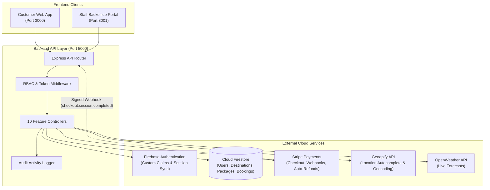
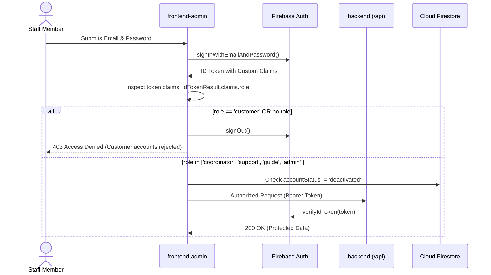

# Lakbay - Philippine Tour & Travel Booking Platform

**Lakbay** (Tagalog for *"Journey"* / *"Travel"*) is a comprehensive, production-ready Tour and Travel Booking Platform priced exclusively in **Philippine Pesos (PHP / ₱)**. 

The platform allows travelers to explore Philippine island destinations, view day-by-day itineraries, check live destination weather and interactive route maps, reserve departure slots, and securely check out with Stripe. It also provides a backoffice portal for Tour Coordinators, Customer Support Agents, Licensed Tour Guides, and System Administrators.

---

## Architecture Overview

The system is architected as **3 standalone applications** running on a unified containerized Docker bridge network (`lakbay-net`):

```
Lakbay/
├── backend/                   # Node.js + Express REST API (Port 5000)
├── frontend-customer/         # React 18 + Vite Customer Web App (Port 3000)
├── frontend-admin/            # React 18 + Vite Staff Backoffice Portal (Port 3001)
├── docker-compose.yml         # Container orchestration across all services
├── firestore.rules            # Production Cloud Firestore security rules
├── storage.rules              # Cloud Storage upload security rules
├── .env                       # Root environment variables configuration
└── .env.example               # Template environment configuration
```

| Component | Directory | Technology Stack | Port | Primary Responsibilities |
| :--- | :--- | :--- | :--- | :--- |
| **Backend API** | [`/backend`](file:///home/isaiah/Projects/Lakbay/backend) | Node.js, Express, Firebase Admin SDK, Stripe SDK | `5000` | REST API, RBAC middleware, seat reservations, Stripe Checkout/webhooks, Geoapify/OpenWeather proxies, audit logging. |
| **Customer Web** | [`/frontend-customer`](file:///home/isaiah/Projects/Lakbay/frontend-customer) | React 18, Vite, Tailwind CSS, shadcn/ui JS, Leaflet | `3000` | Public discovery, destination maps, 5-day weather calendar, Stripe Checkout, booking hub, customer dashboard. |
| **Staff Portal** | [`/frontend-admin`](file:///home/isaiah/Projects/Lakbay/frontend-admin) | React 18, Vite, Tailwind CSS, shadcn/ui JS | `3001` | Role-based backoffice: Coordinator, Support, Tour Guide, and Administrator tools, staff settings. |

---

## System Workflows



### End-to-End Operational Lifecycle
1. **Catalog Setup**: Tour Coordinators create **Destinations** (with Geoapify GPS auto-geocoding) and configure **Tour Packages** (pricing in PHP, inclusions/exclusions, cancellation cutoff, and day-by-day itineraries).
2. **Departure Scheduling**: Coordinators schedule **Departures** (calendar dates, participant capacity, and assigned licensed guides).
3. **Discovery & Exploration**: Customers search destinations with debounced autocomplete, view activity locations on Leaflet maps, and check 5-day weather forecasts before booking.
4. **Booking & Seat Guard**: When a customer books a trip, the backend verifies capacity. If seats are available, it initializes a Stripe Checkout session.
5. **Payment Webhook Verification**: Stripe sends a signed webhook (`checkout.session.completed`). The backend verifies the signature, updates the booking status to `Confirmed`, records the payment, increments the departure's `bookedCount`, and notifies the customer.
6. **Support & Operations**: Support agents use the **Booking Hub** to add internal staff notes, view traveler emergency contacts, and reschedule bookings. If a customer qualifies for an emergency exception, staff can trigger a manual exception refund directly to the traveler's card.
7. **Day-of-Tour Execution**: Tour Guides log in on mobile or desktop to view their **Guide Manifest**, check real-time destination weather, perform passenger check-ins with one-tap checkboxes, and mark the departure as `Completed`.

---

## User Roles & Access Control (RBAC)

The platform enforces Role-Based Access Control at two levels: client-side route guards (`RoleRoute.jsx`) and backend server-side token verification middlewares (`verifyToken`, `requireRoles`, `requireAdminOnly`).

| Role | Target Application | Permissions & Capabilities |
| :--- | :--- | :--- |
| **`customer`** | `frontend-customer` | Discover packages, view maps/weather, book departures, manage co-travelers, view notifications, self-cancel within the cutoff window. **Strictly blocked from `frontend-admin`.** |
| **`admin`** | `frontend-admin` | Superuser with full system access. Manages Staff IAM (create accounts, assign roles, deactivate accounts), views KPI revenue analytics, exports financial CSV reports, audits activity logs. |
| **`coordinator`** | `frontend-admin` | Manages travel catalog (Destinations, GPS coordinates, Packages, day-by-day itineraries), schedules trip Departures, assigns Tour Guides, tracks seat capacities. |
| **`support`** | `frontend-admin` | Manages customer bookings in the Booking Hub, adds internal staff notes, reschedules passenger dates to open departures, reviews and processes Stripe exception refunds. |
| **`guide`** | `frontend-admin` | Mobile-friendly Guide Manifest view. Inspects assigned trips, monitors live destination weather, checks in passengers at boarding, marks tours as completed. |

### Permissions Matrix

| Feature / Resource | `customer` | `guide` | `support` | `coordinator` | `admin` |
| :--- | :---: | :---: | :---: | :---: | :---: |
| Browse Public Catalog & Maps | ✅ | ✅ | ✅ | ✅ | ✅ |
| Book Departures & Checkout | ✅ | ❌ | ❌ | ❌ | ❌ |
| Self-Cancel within Cutoff Window | ✅ | ❌ | ❌ | ❌ | ❌ |
| Access Staff Backoffice (`/frontend-admin`) | ❌ | ✅ | ✅ | ✅ | ✅ |
| Staff Account Settings (`/settings`) | ❌ | ✅ | ✅ | ✅ | ✅ |
| Guide Manifest & Check-in Checklists | ❌ | ✅ | ❌ | ✅ | ✅ |
| Manage Destinations & Packages | ❌ | ❌ | ❌ | ✅ | ✅ |
| Schedule Departures & Guide Assignments | ❌ | ❌ | ❌ | ✅ | ✅ |
| Booking Hub (Rescheduling & Internal Notes) | ❌ | ❌ | ✅ | ✅ | ✅ |
| Manual Exception Refunds (Stripe) | ❌ | ❌ | ✅ | ❌ | ✅ |
| Operations KPI Dashboard | ❌ | ❌ | ✅ | ✅ | ✅ |
| User & Staff IAM Management | ❌ | ❌ | ❌ | ❌ | ✅ |
| Date-Filtered Financial CSV Reports | ❌ | ❌ | ❌ | ❌ | ✅ |

---

## Authentication Architecture

Authentication is powered by **Firebase Authentication** coupled with **Cloud Firestore** user profile storage.



### 1. Custom User Token Claims
- Roles are embedded into user JWTs using Firebase Admin SDK: `auth.setCustomUserClaims(uid, { role })`.
- Client applications inspect `idTokenResult.claims.role` on authentication state changes.
- Backend API endpoints verify claims via `req.user.role` on every request.

### 2. Strict Customer Rejection Rule
- The staff portal (`frontend-admin`) strictly prohibits customer logins. If a user with `role === 'customer'` logs in, `StaffAuthContext.jsx` immediately signs them out and displays:
  > *"Access Denied: Customer accounts cannot access the Lakbay Staff Portal."*

### 3. Deactivated Account Guard
- If a staff member or customer has their status set to `deactivated` or `disabled` in Firestore, authentication middleware rejects their session and forces a logout.

### 4. Account Settings & Password Management
- Accessible to all staff roles at `/settings` via the profile dropdown menu in the sidebar footer.
- Changing passwords requires re-authentication (`reauthenticateWithCredential`) with the user's current password before dispatching `updatePassword` to Firebase Auth.
- Profile changes (Full Name, Phone Number, Guide Bio) instantly update local state via `updateProfileState` without requiring a page reload.

---

## Security & Data Integrity

### 1. Cloud Firestore Rules ([`firestore.rules`](file:///home/isaiah/Projects/Lakbay/firestore.rules))
- **Role Helpers**: Custom rule functions (`isAdmin()`, `isCoordinator()`, `isSupport()`, `isGuide()`, `isCustomer()`) validate access against token claims.
- **Client Write Lockouts**: 
  - Mutations to `bookings`, `payments`, and `activityLogs` are completely disallowed from client SDKs (`allow write: if false;`). All booking creations, payments, cancellations, and status updates must execute through the trusted Node.js `backend`.
- **User Document Isolation**: Customers can only read and update their own profile document. The `role` and `createdAt` fields are strictly immutable from the client.
- **Published Catalog Filtering**: Unauthenticated visitors can only query packages and destinations where `isPublished == true`.

### 2. Cloud Storage Rules ([`storage.rules`](file:///home/isaiah/Projects/Lakbay/storage.rules))
- **File Validation**: Uploads are restricted to image MIME types (`image/jpeg`, `image/png`, `image/webp`).
- **File Size Guard**: Maximum file size is capped at 5 MB (`request.resource.size <= 5 * 1024 * 1024`).
- **Destination & Package Assets**: Only `admin` and `coordinator` roles can upload images to `/destinations/` and `/packages/`.

### 3. Backend HTTP Security
- **Helmet**: Enforces secure HTTP response headers (`helmet()`).
- **CORS Whitelist**: Restricts cross-origin requests to configured client URLs (`http://localhost:3000` for customers and `http://localhost:3001` for staff).
- **Raw Webhook Buffering**: Preserves the unparsed raw request body buffer specifically for `/api/webhooks/stripe` to ensure cryptographic HMAC signature validation (`stripe.webhooks.constructEvent`).
- **Audit Logging**: Sensitive administrative actions (creating users, changing roles, cancelling departures, issuing exception refunds) are logged to the `activityLogs` Firestore collection with actor UID, role, timestamp, and target metadata.
- **Non-Root Docker Execution**: The backend container runs under the dedicated `USER node` rather than root.

---

## External Services Configuration

### 1. Firebase (Admin SDK & Client SDK)
- **Firebase Auth**: User accounts, password management, and custom token claims.
- **Cloud Firestore**: Primary NoSQL database for destinations, packages, departures, bookings, payments, and audit logs.
- **Firebase Storage**: Image uploads for destinations, packages, and avatars.

### 2. Stripe Payments (PHP Currency)
- **Stripe Checkout**: Redirects customers to a secure Stripe-hosted payment page in PHP (`₱`).
- **Stripe Webhooks**: Listens for `checkout.session.completed` to finalize bookings and verify payment.
- **Automated & Exception Refunds**: Dispatches programmatic refunds (`stripe.refunds.create`) directly back to the customer's payment card when a booking is cancelled.

### 3. Geoapify API
- **Location Autocomplete**: Debounced search input on the customer homepage for Philippine landmarks, islands, and provinces.
- **GPS Reverse Geocoding**: One-click coordinate lookup (`LocateFixed`) in the admin portal to automatically assign latitude and longitude to destinations.

### 4. OpenWeather API
- **Live Destination Weather**: Displays current temperature, weather conditions, humidity, and wind speed.
- **5-Day Weather Forecasts**: Displayed in the customer booking calendar and tour guide manifest to help travelers prepare for departures.

---

## Getting Started

### Prerequisites
- [Node.js 20+ LTS](https://nodejs.org/)
- [Docker](https://docs.docker.com/get-docker/) & [Docker Compose](https://docs.docker.com/compose/)
- A Firebase project with **Authentication** and **Cloud Firestore** enabled.

---

### Step 1: Environment Configuration

Copy the root `.env.example` to `.env`:

```bash
cp .env.example .env
```

Edit `.env` and fill in your credentials:

```ini
# Application URLs
API_BASE_URL=http://localhost:5000
CLIENT_URL=http://localhost:3000
ADMIN_URL=http://localhost:3001

# Firebase Client SDK (Used by frontend-customer and frontend-admin)
VITE_FIREBASE_API_KEY=your_api_key
VITE_FIREBASE_AUTH_DOMAIN=your_project.firebaseapp.com
VITE_FIREBASE_PROJECT_ID=your_project_id
VITE_FIREBASE_STORAGE_BUCKET=your_project.firebasestorage.app
VITE_FIREBASE_MESSAGING_SENDER_ID=your_sender_id
VITE_FIREBASE_APP_ID=your_app_id
VITE_API_BASE_URL=http://localhost:5000/api

# Stripe Configuration
STRIPE_SECRET_KEY=sk_test_...
STRIPE_PUBLISHABLE_KEY=pk_test_...
STRIPE_WEBHOOK_SECRET=whsec_...
STRIPE_CURRENCY=php

# External Services
GEOAPIFY_API_KEY=your_geoapify_key
OPENWEATHER_API_KEY=your_openweather_key

# Default Administrator Account (Used during seeding)
ADMIN_EMAIL=admin@lakbay.ph
ADMIN_PASSWORD=AdminPassword123!
ADMIN_NAME=Lakbay Administrator
```

---

### Step 2: Firebase Service Account Key

Place your Firebase Admin service account key inside the `backend` folder:

```bash
# Path:
backend/serviceAccountKey.json
```

*(Note: `serviceAccountKey.json` is ignored by git to safeguard your private keys).*

---

### Step 3: Running the Entire Platform with Docker

From the root project folder, run:

```bash
docker compose up --build
```

*(Add `-d` to run in detached background mode: `docker compose up --build -d`)*

Once started, access the applications:

| Application | URL | Description |
| :--- | :--- | :--- |
| **Customer Web App** | [http://localhost:3000](http://localhost:3000) | Public catalog, discovery, booking, account dashboard |
| **Staff Backoffice Portal** | [http://localhost:3001](http://localhost:3001) | Staff login, operations, catalog, IAM, reports |
| **Backend REST API** | [http://localhost:5000/api/health](http://localhost:5000/api/health) | Health check, documentation, REST endpoints |

To stop all containers:
```bash
docker compose down
```

---

### Step 4: Running Locally (Development Mode)

If you prefer running services directly on your host machine without Docker:

#### 1. Start the Backend API
```bash
cd backend
npm install
npm run dev
```

#### 2. Seed the Initial Administrator & Catalog
```bash
cd backend
# 1. Create the primary admin account (admin@lakbay.ph)
npm run seed:admin

# 2. Seed sample destinations, tour packages, and departure dates
npm run seed:demo
```

#### 3. Start the Customer Web Application
```bash
cd frontend-customer
npm install
npm run dev
```
*(Runs on `http://localhost:3000`)*

#### 4. Start the Staff Backoffice Portal
```bash
cd frontend-admin
npm install
npm run dev
```
*(Runs on `http://localhost:3001`)*

---

## Initial Staff Login Credentials

After running `npm run seed:admin`, log in to the Staff Portal (`http://localhost:3001`):

- **Email**: `admin@lakbay.ph`
- **Password**: `AdminPassword123` *(or the password configured in your `.env`)*
- **Role**: `admin`

From the Staff IAM page (`/administration/staff-customers`), administrators can create additional accounts with roles for `coordinator`, `support`, or `guide`.

---

## License

This project is licensed under the MIT License.
